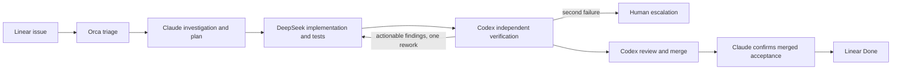

# Contract Master

Shared contracts and durable state for repository work coordinated by Orca.



Start with [AGENTS.md](AGENTS.md). This repository contains policies, schemas,
registry, a Python standard-library manager, and automated simulations. Product
code, product tests and API contracts stay in target repositories.

```bash
python3 -m unittest discover -s tests -v
python3 -m contract_master doctor
python3 -m contract_master --help
```

No package install or API credential is needed for the simulations. Python 3.9+
and Git are required. Run from the repository root; the supported deployment is
this checkout (schemas and config are deliberately repository-owned assets).
On Windows use `py -3` from PowerShell 7 and configure the registry's check argv
for the installed Python executable.

[Workflow](docs/policies/workflow.md) · [Contracts](docs/contracts/v1.md) ·
[Onboarding](docs/onboarding/repositories.md) · [Pilot](docs/operations/pilot.md) ·
[HANDOFF](docs/operations/HANDOFF.md)

Linear: [Contract Master Automation](https://linear.app/d3space/project/contract-master-automation-cd76eeeb4af9),
tracking [D3S-98](https://linear.app/d3space/issue/D3S-98),
implementation [D3S-99](https://linear.app/d3space/issue/D3S-99).

Automation is enabled: one Orca scheduled automation runs the
[coordinator turn](docs/operations/coordinator-prompt.md) every ten minutes. The
DeepSeek runner is enabled on an [isolated worker host](docs/operations/worker-host.md),
and reviewed master commits are pinned in the registry. [Activation gates](docs/operations/pilot.md)
record the setup; the pilot's first executable issue (gate 8) is still to come.
